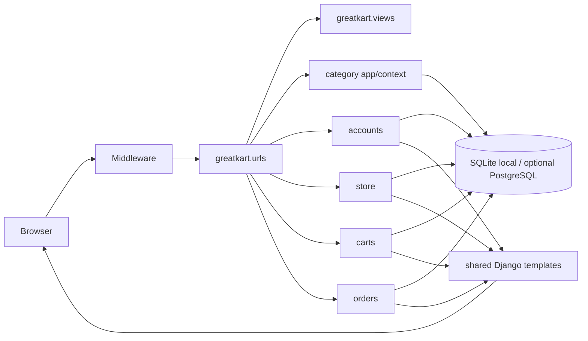

# Architecture

`python manage.py runserver` starts at `manage.py`, which sets `DJANGO_SETTINGS_MODULE=greatkart.settings` and calls Django's command runner. Settings configure installed apps, middleware, templates, database, static/media paths, authentication and email. The development server dispatches WSGI requests through middleware and `greatkart.urls`; ASGI is available through `greatkart/asgi.py` for ASGI servers. WSGI is configured in `greatkart/wsgi.py`.

Root routes select the home view or include each app's URL table. Views validate request input, query or mutate ORM models, and render templates or redirect/return JSON. Django middleware establishes sessions, authentication, CSRF protection and messages. The authentication app uses a custom `accounts.Account`; session state also identifies anonymous carts. Template context processors provide category links and cart count. Static files are served from `greatkart/static/` in development; uploaded media is stored beneath `media/` locally. SQLite is selected unless RDS environment variables are set.

Cross-app dependencies follow the workflows: products point to categories and accounts; cart items point to products, variations, users and anonymous cart rows; orders point to users, payment records and order products; reviews point to product and account. Email uses Django's configured backend; local default prints messages to the console. Runtime secrets/configuration are read through `python-decouple` from environment or `.env` when present.

The built-in `runserver` and local filesystem settings are for development and evaluation. Production serving, static collection/CDN, secret management, HTTPS, secure cookie settings, mail delivery, database operations and payment verification are intentionally outside this local demo's scope.
