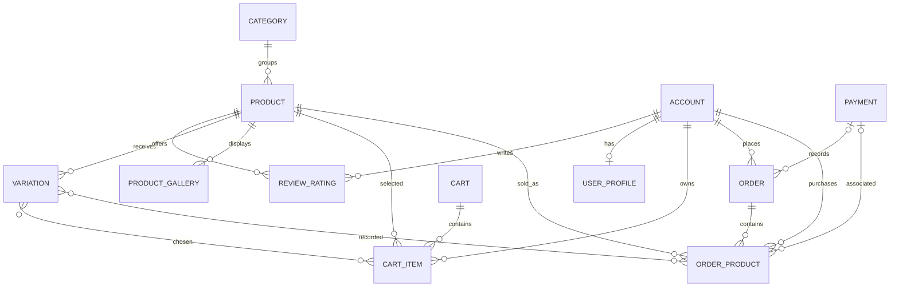

# Database schema

The configured local database is SQLite at `BASE_DIR/db.sqlite3`; if `RDS_DB_NAME` exists, settings switch to PostgreSQL and expect the remaining RDS variables. No database was present at audit. Django's built-in auth/contenttypes/session/admin tables are framework tables; migrations in each app define project models. All project model primary keys use Django's default integer key unless overridden. No explicit indexes or `UniqueConstraint` declarations were found.

| App/model | Fields and relationships | Purpose / workflow |
|---|---|---|
| category.Category | `category_name` Char(50), `slug` Slug(100) unique; `description` Text(255) blank; `cat_image` Image blank | Catalog grouping. Product FK uses `CASCADE`; category menu/context and catalog views read it. |
| accounts.Account | AbstractBaseUser; names, unique username/email, phone; join/login timestamps; admin/staff/active/superadmin booleans | Custom email-login identity. `MyAccountManager` creates users and hashes passwords. |
| accounts.UserProfile | user OneToOne Account `CASCADE`; two address lines, image, city/state/country (blank) | Optional profile details, created during registration. |
| store.Product | unique name/slug, description, integer price/stock, image, available flag, Category FK `CASCADE`, created/modified timestamps | Catalog item, read by store/search/cart/order; `get_url`, average/count review methods. |
| store.Variation | Product FK `CASCADE`; category choice color/size; value, active, created timestamp | Optional product options linked M2M from cart/order item. |
| store.ReviewRating | Product and Account FKs `CASCADE`; subject/review, float rating, IP, status, timestamps | User product feedback; only status=true reviews are shown. |
| store.ProductGallery | Product FK `CASCADE`; image | Extra product imagery. |
| carts.Cart | session `cart_id`, `date_added` | Anonymous cart identity. |
| carts.CartItem | nullable Account FK and Cart FK, both `CASCADE`; Product FK `CASCADE`; Variation M2M; quantity, active | Cart line; subtotal is price × quantity. |
| orders.Payment | Account FK `CASCADE`; payment id/method/amount/status strings, created timestamp | Demo transaction metadata; not evidence of a real payment. |
| orders.Order | nullable Account and Payment FKs, both `SET_NULL`; order number, billing fields, total/tax floats, status choice, IP, ordered flag, timestamps | Billing snapshot and order lifecycle. |
| orders.OrderProduct | Order FK `CASCADE`; nullable Payment FK `SET_NULL`; Account and Product FKs `CASCADE`; Variation M2M; quantity, price float, ordered flag, timestamps | Snapshot-ish order line; product FK means product deletion removes the line. |

No explicit `related_name` values are set; Django defaults apply. Product/category names/slugs and Account email/username are unique. Other displayed fields are not explicitly indexed. Nullable fields are called out above; required fields have no explicit default unless noted. Field details should be rechecked against model source after schema edits.

Adding to cart selects the product and optional variations, then creates/increments a `CartItem` associated with either the signed-in account or a session `Cart`. Checkout displays server-calculated totals. `place_order` saves billing details and a computed order total. The local demo endpoint verifies order ownership and stock, creates server-generated demo metadata and order lines, decrements stock and deletes the cart within a database transaction. This records an order only; it does not process or verify payment.
